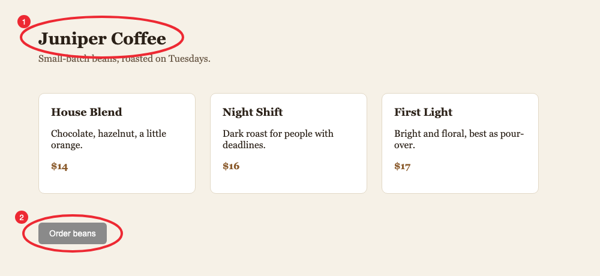

# Redline

Draw on your screen, say what you want, and send it to your coding agent.

Redline puts a see-through layer over your screen. Turn the pen on, circle the things you
want changed while you talk, and press send. Your agent gets a picture of the window you
marked, your marks numbered in the order you drew them, and your words with each mark
placed where you drew it:

> make this heading bigger **[mark 1]** and make this button green **[mark 2]**



Redline has no AI of its own and needs no API key. It hands turns to the agent you already
use, such as Codex or Claude Code.

**Status: early, macOS only.** It works on the author's Mac. Linux is planned but not
built. See [What works and what doesn't](#what-works-and-what-doesnt).

## Using it

| Key | What it does |
|---|---|
| Ctrl+Alt+D | Pen on or off. While it is on, the microphone records and the menu bar shows "● Redline". |
| Ctrl+Alt+N | Open the settings window to type a note for this turn. |
| Ctrl+Alt+S | Send the turn. |
| Ctrl+Alt+C | Clear the ink, the notes and what was recorded. |

Everything is also in the **Redline** menu in the menu bar, along with "Send whole screen",
Settings and Quit. With the pen off, clicks go straight through to whatever is underneath.

A turn pictures only the window your marks sit on. Marks spread over several windows, or
"Send whole screen", picture the whole screen instead.

## Getting a turn to your agent

There are two ways. Use either or both.

### 1. Redline starts your agent for you

Open **Settings…** from the menu, choose your project folder and pick Codex or Claude Code.
Each turn then runs that agent in your project with the picture and your words, lets it
edit files there, and shows its answer at the bottom-left of the screen.

- Codex runs as `codex exec` with the `workspace-write` sandbox.
- Claude Code runs as `claude -p` with `--permission-mode acceptEdits`.
- For anything else, set `"agent": "custom"` and an `"agent_command"` in
  `~/.redline/config.json`. The command runs in the project folder with `REDLINE_PROMPT`,
  `REDLINE_IMAGE`, `REDLINE_TURN` and `REDLINE_PROJECT` set.

### 2. Your agent fetches turns over MCP

`redline/mcp/server.mjs` is an MCP server with two tools: `wait_for_turn`, which blocks until
you send one, and `latest_turn`. Add it to your agent, then tell the agent to wait for
Redline turns and act on each one.

```sh
# Claude Code
claude mcp add redline -- node /path/to/redliner/redline/mcp/server.mjs

# Codex
codex mcp add redline -- node /path/to/redliner/redline/mcp/server.mjs
```

Codex asks for approval before calling an MCP tool. For runs where nobody is there to
approve, add `default_tools_approval_mode = "approve"` under `[mcp_servers.redline]` in
`~/.codex/config.toml`.

## Building

You need Rust (via [rustup](https://rustup.rs)), Xcode's command-line tools and Node.js.

```sh
scripts/build-macos.sh        # builds dist/Redline.app and a zip of it
open dist/Redline.app
```

macOS will ask for Screen Recording and Microphone access the first time each is used. The
app is signed ad hoc and not notarized, so on another Mac you have to right-click it and
choose Open the first time.

### Dictation

Speech is turned into text on your Mac with [whisper.cpp](https://github.com/ggml-org/whisper.cpp).
For now that needs two Homebrew packages and a model file:

```sh
brew install sox whisper-cpp
mkdir -p ~/.redline/models
curl -L -o ~/.redline/models/ggml-base.bin \
  https://huggingface.co/ggerganov/whisper.cpp/resolve/main/ggml-base.bin
```

Without them Redline still works; turns just carry no speech. The settings window says
which piece is missing.

## Settings

`~/.redline/config.json`, all keys optional:

```json
{
  "project": "/path/to/your/project",
  "agent": "codex",
  "agent_command": "",
  "hotkeys": { "pen": "ctrl+alt+d", "send": "ctrl+alt+s", "clear": "ctrl+alt+c", "note": "ctrl+alt+n" }
}
```

`agent` is `off`, `codex`, `claude` or `custom`. Hotkey changes take effect the next time
Redline starts.

## Privacy

- Recording, transcription and screenshots all happen on your Mac. Redline sends nothing
  anywhere itself.
- A turn is a folder in `~/.redline/turns/` holding the picture and a `turn.json`. Whatever
  agent you connect sees that picture, so it goes wherever that agent sends its input.
- The microphone records only while the pen is on, and the screen says so. The audio file is
  deleted once the turn is written.
- Turns are never deleted automatically. Clear out `~/.redline/turns/` when you like.

## What works and what doesn't

Tested on one Mac (Apple silicon, one display):

- Overlay, pen, numbered marks, hotkeys, menu-bar controls
- Dictation with marks placed among the words
- Typed notes
- Window-only capture
- Starting Codex on a turn, and Codex fetching a turn over MCP

Not done or not tested:

- **Linux.** Nothing is built for it yet. The UI framework supports it; screen capture,
  recording and the tray item need writing.
- **Claude Code** as the agent: the code path exists but has not been run.
- **A second display.** Marks there fall back to a whole-screen picture.
- **Dictation without Homebrew.** The recorder and speech engine are not bundled.
- **Notarization.** The app is not signed with a developer certificate.

## What's in this repository

| Folder | What it is |
|---|---|
| `redline/` | The app: Rust, built on [Rune](https://github.com/anomalyco/rune), with a small Swift helper for window capture and a native menu-bar item |
| `redline/mcp/` | The MCP server agents use to fetch turns |
| `canvas/` | An earlier experiment: a tldraw board an agent can read and write |
| `demo-site/` | A one-page site to try Redline on |
| `scripts/` | The macOS build script |

## Licence

MIT. See [LICENSE](LICENSE).
